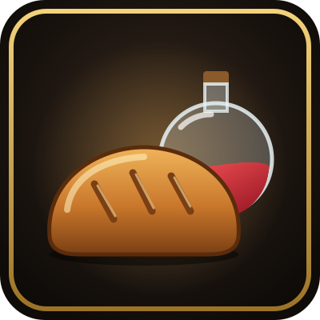
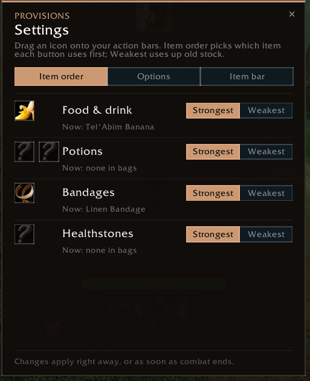
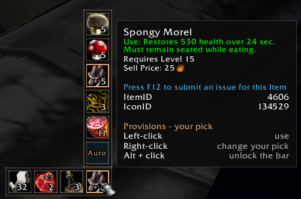
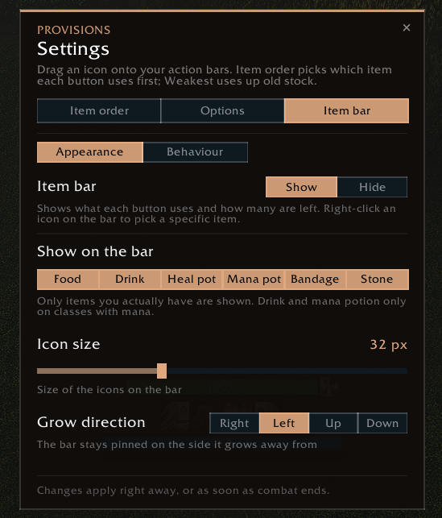
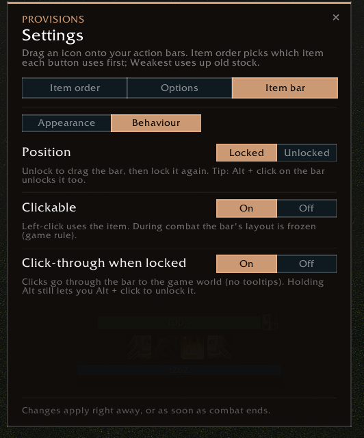

<h1 align="center">Provisions</h1>

<b>One button to eat, drink, potion or bandage, always with the best item in your bags. Plus raid bars for your flasks, elixirs and stims.</b> 
A WoW Forever addon.

<a href="https://github.com/zmann85/Provisions/releases/latest"><b>⬇️ Download the latest version</b></a> &nbsp;·&nbsp; <a href="CHANGELOG.md">What's new</a>

Provisions keeps a few general macros pointed at the right consumable. When you loot new food, level up or run out of a stack, **the buttons update themselves**. Put them on your bars once and never think about it again.

**Any game language:** Provisions knows the game's food, drink, potions, bandages and healthstones by their item ID, so it works whatever language your game is in. (An item added to the game later is only recognized on an English client, until Provisions' table has it.)

## Install
1. Open the [latest release](https://github.com/zmann85/Provisions/releases/latest) and download the `Provisions-…zip` file under **Assets**.
2. Unzip it into `World of Warcraft\_forever_\Interface\AddOns\` (you should end up with an `AddOns\Provisions` folder).
3. Start the game or type `/reload`.

To update, repeat this and replace the old folder. Your settings are kept.

## Getting started
1. Log in. Provisions creates its buttons automatically.
2. Type `/prov` or click the **bread icon** on your minimap.
3. On the **Item order** tab, **drag the buttons onto your action bars**. Done.

## The buttons
| Button | Uses |
|---|---|
| **EatDrink** | Best food and drink in one press, or as separate **Eat** and **Drink** buttons |
| **HealPot** | Best healing potion |
| **ManaPot** | Best mana potion |
| **Bandage** | Best bandage your First Aid skill allows |
| **Healthstone** | Best healthstone |
| **Rune** | Demonic Rune or Dark Rune (characters with mana) |
| **BuffFood** | Best Well Fed dish: its stat buff, plus +5% experience from kills in WoW Forever |

**Smart picks**
- **Strongest first** by default, or **weakest first** per group to use up old stock
- **Conjured** food and drink first, since they vanish on logout anyway
- **Skips buff food**, so your Well Fed food isn't wasted on regen
- Characters without mana **never get drinks**

## The item bar
A small bar shows what each button would use and how many you have left.
- **Click** an icon to use the item, **right-click** to pick a specific item for that slot
- Choose which item types appear, plus icon size and grow direction
- Lock it or make it click-through. **Alt + click** unlocks it any time

- Two small buttons at its end show or hide the raid bars

## Raid bars
Two more bars for your own raid consumables, a separate list for each character:
- **Raid bar**: lasting buffs like flasks, elixirs, buff food, juju, world buffs, scrolls, weapon oils and stones
- **Raid stims bar**: short-use items for certain fights, like protection potions, Free Action and Stoneshield

How they work:
- **Drag** an item from your bags onto a bar to add it, **click** to use it. Oils, stones and poisons go straight onto your weapon
- Items you've run out of stay greyed out with 0, as a restock reminder
- An icon **pulses orange** when you carry the item but its buff isn't on you (in raids), and gets a **green frame** with the time left while the buff is up
- **Right-click** an icon to move it, remove it or switch its glow. **Presets** fill both bars at once, starting with Protection Paladin
- Works in any game language: the buff is read from the game, not from tooltip text

## Settings
Everything is in one window: `/prov` or the minimap button.
- **Item order**: your buttons to drag onto your bars, and strongest or weakest first per group
- **Options**: one or two food & drink buttons, conjured first, skip buff food
- **Item bar**: what the bar shows, how it looks and how it behaves
- **Raid bar**: a page each for the raid bar and the raid stims bar, plus presets

Options and the bar layout are shared by all your characters. Item order, bar items, right-click picks and the raid bar lists are saved per character.

 

| Command | |
|---|---|
| `/prov` | Open the settings window |
| `/prov info` | Show what each button currently uses |
| `/prov raid`, `/prov stims` | Raid bar and raid stims commands (add, list, clear, preset) |
| `/prov resetbar` | Move all bars back to the centre |
| `/prov minimap` | Show or hide the minimap button |
| `/prov reset` | Factory reset |
| `/prov debug` | List your consumables and how Provisions sees them (for bug reports) |

## Lightweight
It only scans when your bags change and never reads the combat log. Nothing it does in combat can get blocked, and it doesn't touch buff data the game keeps secret during fights.

## Bugs & ideas
Open an [issue](https://github.com/zmann85/Provisions/issues), or tell Ghaan in game. A screenshot of `/prov debug` helps a lot.

---

For the author: releasing

1. Put the new version as the first `## vX.Y` heading in `CHANGELOG.md` with its changes, commit and push to main.
2. GitHub Actions tags the commit, builds the zip, creates the GitHub release and uploads it to CurseForge.

Needs the repository secret `CF_API_KEY`. CurseForge project ID 1738354. The CurseForge description lives in `CURSEFORGE.html` (paste into the editor's source view).

