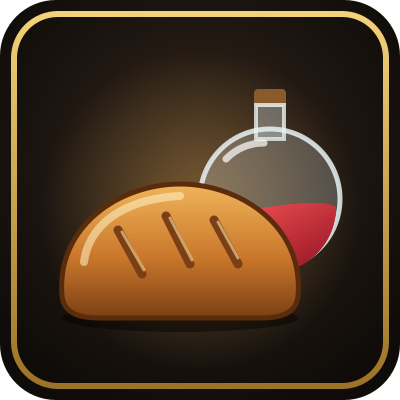
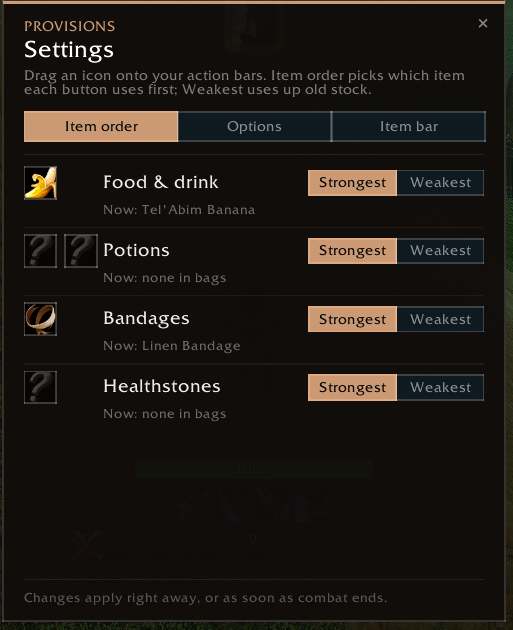
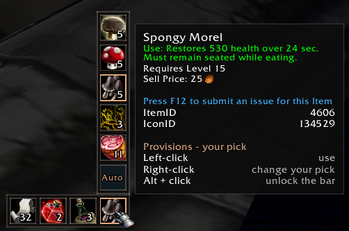
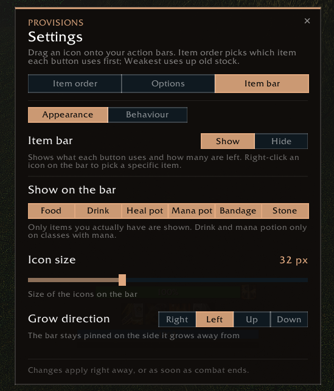
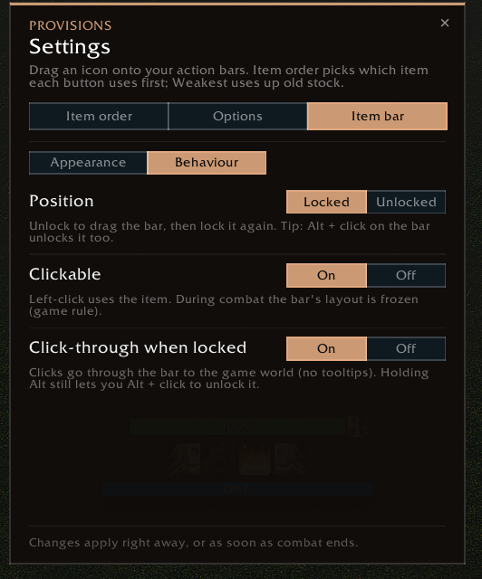

<h1 align="center">Provisions</h1>

<b>One button to eat, drink, potion or bandage, always with the best item in your bags.</b> 
A WoW Forever addon.

<a href="https://github.com/zmann85/Provisions/releases/latest"><b>⬇️ Download the latest version</b></a> &nbsp;·&nbsp; <a href="CHANGELOG.md">What's new</a>

Provisions keeps a few general macros pointed at the right consumable. When you loot new food, level up or run out of a stack, **the buttons update themselves**. Put them on your bars once and never think about it again.

**English game client only:** Provisions tells what an item does from its tooltip text ("Use: Restores … health"), and it reads that text in English.

## Install
1. Open the [latest release](https://github.com/zmann85/Provisions/releases/latest) and download the `Provisions-…zip` file under **Assets**.
2. Unzip it into `World of Warcraft\_classic_beta_\Interface\AddOns\` (you should end up with an `AddOns\Provisions` folder).
3. Start the game or type `/reload`.

To update, repeat this and replace the old folder. Your settings are kept.

## Getting started
1. Log in. Provisions creates its buttons automatically.
2. Type `/prov` or click the **bread icon** on your minimap.
3. On the **Item order** tab, **drag the buttons onto your action bars**. Done.

## The buttons
| Button | Uses |
|---|---|
| **EatDrink** | Best food and drink in one press, or as separate **Eat** and **Drink** buttons |
| **HealPot** | Best healing potion |
| **ManaPot** | Best mana potion |
| **Bandage** | Best bandage your First Aid skill allows |
| **Healthstone** | Best healthstone |

**Smart picks**
- **Strongest first** by default, or **weakest first** per group to use up old stock
- **Conjured** food and drink first, since they vanish on logout anyway
- **Skips buff food**, so your Well Fed food isn't wasted on regen
- Characters without mana **never get drinks**

## The item bar
A small bar shows what each button would use and how many you have left.
- **Click** an icon to use the item, **right-click** to pick a specific item for that slot
- Choose which item types appear, plus icon size and grow direction
- Lock it or make it click-through. **Alt + click** unlocks it any time

## Settings
Everything is in one window: `/prov` or the minimap button.
- **Item order**: your buttons to drag onto your bars, and strongest or weakest first per group
- **Options**: one or two food & drink buttons, conjured first, skip buff food
- **Item bar**: what the bar shows, how it looks and how it behaves

Options and the bar layout are shared by all your characters. Item order, bar items and right-click picks are saved per character.

 

| Command | |
|---|---|
| `/prov` | Open the settings window |
| `/prov info` | Show what each button currently uses |
| `/prov resetbar` | Move the bar back to the centre |
| `/prov minimap` | Show or hide the minimap button |
| `/prov reset` | Factory reset |
| `/prov debug` | List your consumables and how Provisions sees them (for bug reports) |

## Lightweight
It only scans when your bags change and never reads the combat log. Nothing it does in combat can get blocked.

## Bugs & ideas
Open an [issue](https://github.com/zmann85/Provisions/issues), or tell Ghaan in game. A screenshot of `/prov debug` helps a lot.

---

For the author: releasing

1. Put the new version as the first `## v1.6` heading in `CHANGELOG.md` with its changes, commit and push to main.
2. GitHub Actions tags the commit, builds the zip, creates the GitHub release and uploads it to CurseForge.

Needs the repository secret `CF_API_KEY`. CurseForge project ID 1738354. The CurseForge description lives in `CURSEFORGE.html` (paste into the editor's source view).

